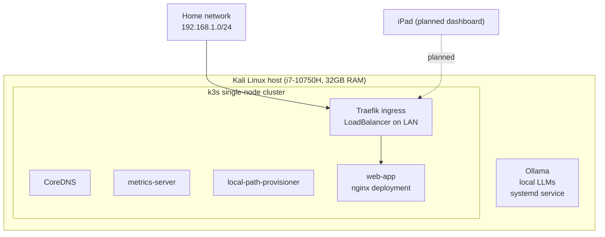

# Homelab

A self-hosted cloud-security and infrastructure lab I run on a single Linux host. I use it to learn and practice containers, Kubernetes, monitoring, and security operations by actually building and breaking things, then documenting how each part works.

This repo is the source of truth for the lab: every service has a manifest or script here, so the whole thing can be rebuilt from these files rather than from memory.

## Current state (verified 5 Nov 2026)

| Layer | What is running | Status |
|---|---|---|
| Host | Kali Linux, Intel i7-10750H, 32 GB RAM | up |
| Container runtime | Docker | installed |
| Orchestration | k3s (single-node Kubernetes), v1.37.1 | healthy, 1 node Ready |
| Workload | `web-app` (nginx), 1 replica | running |
| Local AI | Ollama (llama3.1:8b, llama3.2:3b, qwen2.5:14b) | running as a service |
| Ingress | Traefik (ships with k3s), reachable on the LAN | running |

Honest note on maturity: this is an early lab. The Kubernetes workload is a single nginx pod, and monitoring and SIEM layers are planned, not yet built. I am documenting what is real, not what is aspirational.

## Architecture



## Repo layout

```
homelab/
├── README.md                     this file
├── kubernetes/
│   └── web-app/
│       ├── deployment.yaml       the nginx workload, as code
│       └── service.yaml          exposes it inside the cluster
├── docs/
│   └── 01-current-state.md       full inventory and how it was verified
└── scripts/                      health checks and helpers (coming)
```

## Rebuild the workload from code

```bash
# point kubectl at the k3s cluster
export KUBECONFIG=~/.kube/config

# apply the web-app as declared in this repo
kubectl apply -f kubernetes/web-app/

# confirm it is running
kubectl get deploy,svc -l app=web-app
```

## Roadmap

Built next, one layer at a time (not all at once, this host is a laptop):
1. A dashboard (Homarr or Homepage) to see every service in one place, reachable from the iPad.
2. Image vulnerability scanning with Trivy.
3. Monitoring: Prometheus and Grafana.
4. A SIEM layer (Wazuh or Security Onion) for log collection and detection.
5. Network segmentation and a firewall (pfSense).

Each layer gets its own folder and a short write-up before it is called done.
